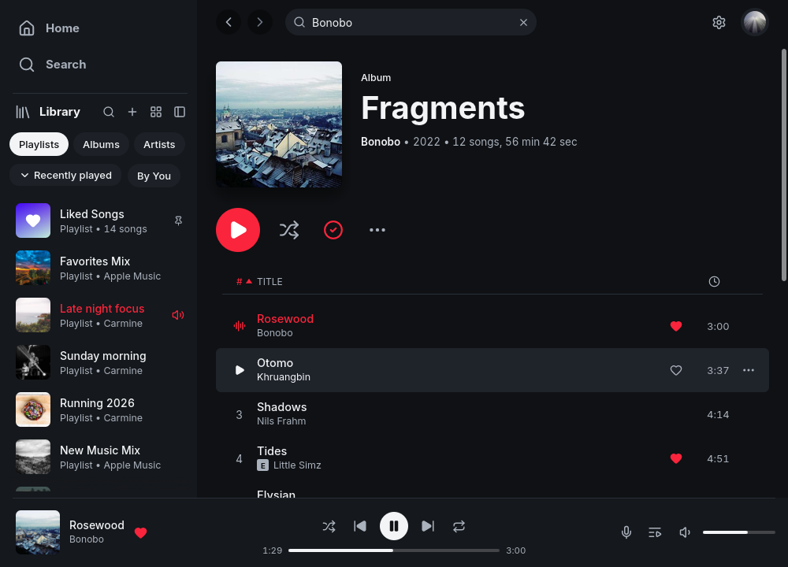

<p align="center">
  
  <br/><sub>実際のアプリ全画面 · デモ用ライブラリ</sub>
</p>

<h1 align="center">melba</h1>
<p align="center"><strong>Linux 向けネイティブ Apple Music クライアント</strong></p>
<p align="center">
  <a href="https://github.com/nekomario28/melba/actions/workflows/ci.yml"></a>
  <a href="https://github.com/nekomario28/melba/releases"></a>
</p>

[English](README.md) | **日本語**

Melba は Rust 製の非公式 Apple Music デスクトッププレイヤー（`melba`）と独立再生デーモン（`melbad`）です。Electron を使わず、ネイティブ egui UI でカタログ検索・ライブラリ・プレイリスト・キュー・同期歌詞・MPRIS・16 言語・署名付きポータブル更新に対応しています。

## インストール

Linux `x86_64` / `aarch64` 対応。**glibc 2.43 以降の環境ではビルド済みの署名付きReleaseからインストールできます。** GitやRustの導入は不要です。glibc が古い Debian 13・Ubuntu 24.04・Fedora 43 などでは下記のソースビルドを利用してください。NixOS は[専用のNixパッケージ](docs/installation.md#nix-and-nixos)を利用します。

```sh
curl -fsSL https://raw.githubusercontent.com/nekomario28/melba/main/packaging/install-release.sh | sh
```

Releaseの発行者署名とSHA-256チェックサムを検証し、`melba`と`melbad`を導入します。Linuxの共有ライブラリが不足している場合は対応ディストリビューションのパッケージマネージャで導入します（必要時は`sudo`認証）。対話環境ではALAC導入を`[Y/n]`で確認します。後からでも[1コマンドで追加](docs/installation.md#enable-alac-lossless)でき、必要な準備ツールも不足時に導入します。非対話環境では`--with-alac`で明示的に指定できます。

**開発者向けソースビルド**では不足する開発パッケージ・Rust・`cargo-about`を自動導入します（必要に応じて`sudo`を使用）。

```sh
git clone https://github.com/nekomario28/melba.git
cd melba
sh packaging/install.sh
melba
```

`packaging/install.sh` は `~/.local/opt/melba` に `melba` と `melbad` を配置し、`~/.local/bin` にコマンドリンクとデスクトップエントリを作成します（`melbad` はデスクトップ起動時に自動起動）。別レイアウトやパッケージ手順、および ALAC 用の外部サービス導入は [インストール詳細](docs/installation.md) を参照してください。wrapper・rootfs・アカウント情報は Melba に同梱されません。

## ALAC（ロスレス）を有効にする

ALACには別途復号サービスが必要です。最初のインストール時に **Y** を選ぶか、導入後に[1コマンドで追加](docs/installation.md#enable-alac-lossless)できます。新しくビルドしたMelbaでは、後から追加する際も対応ディストリビューションで不足ツールを自動導入します。ただし、公開済みの`v0.3.12`の`melbad`にはまだ反映されていません。必要ツールが不足する場合は[署名付きインストーラをALAC指定で再実行](docs/installation.md#enable-alac-lossless)してください。スクリプトを個別に確認したい場合は、独立した[wrapper bootstrap](https://github.com/nekomario28/melba-wrapper-bootstrap)からの手動導入も可能です。

GUIからサインインし、ALACの曲を再生してください。managed serviceは必要時に起動し、CLIでの別途ログインやトークン転記は不要です。第三者ランタイムの利用条件・セキュリティ上の注意事項を確認してください。stagingだけではALAC再生を保証せず、利用不可の場合はAACへフォールバックします。音源のロスレスとbit-perfect出力は別の条件です。詳細は[導入ガイド](docs/installation.md#enable-alac-lossless)を参照してください。

## 再生

`melba` を起動して **Sign in with Apple Music** を選び、Settings または `melbad setup` で出力先を選択します。フルトラック再生には Apple Music の有料契約と有効なセッションが必要です（プレビューは契約不要）。

- **AAC-256（既定）:** 端末に既存の Widevine CDM を使用
- **ALAC / ロスレス（任意）:** 別途導入が必要です（[手順](#alacロスレスを有効にする)）。利用不可なら AAC にフォールバックします。
- **出力:** ALSA 直接出力（`hw:X,Y`）、または共有システム出力（`default` / PipeWire / PulseAudio）
- **診断:** `melbad doctor` でトークン、CDM、wrapper 疎通、音声出力を一括確認

音源がロスレスであることと、出力が bit-perfect であることは別です。認証管理は [認証仕様](docs/authentication.md)、サービスモードは [Wrapper の制御](docs/wrapper.ja.md) を参照してください。

## bit-perfect

`default` / PipeWire / PulseAudio は共有出力であり、bit-perfect とは判定しません。ソースのサンプルレート・チャンネル数・有効ビット深度に一致する `hw:` 直接オープンのみが `BITPERFECT` を返します。

```sh
melbad probe --json
melbad play fixtures/96k-24bit.flac --device hw:0,0 --require-bitperfect --verify
```

`hw:0,0` は実環境に合わせて置き換えてください。判定表・注意事項・receipt 形式は [音声仕様](docs/audio.md) に記載しています。OS ミキサー（PipeWire）を使う場合の無改変パススルー条件（単独ストリーム・リサンプリングなし・音量 100%）や、サンプルレート切り替え時に HDMI AV アンプで曲頭が切れる現象の回避設定（WirePlumber `api.alsa.start-delay`）は [Shared output (PipeWire) on Linux](docs/audio.md#shared-output-pipewire-on-linux) を参照してください。

## 状態

Apple Inc. の非公式クライアントであり、提携・承認は受けていません。`aarch64` リリースはビルド検証済みですが、arm64 実機での動作検証は未実施です。ログイン・再生可否・出力機器・ロスレス再生は利用環境で確認してください。[更新仕様](docs/updates.md) と [ロードマップ](docs/roadmap.md) も参照してください。

## ドキュメント

- [インストール](docs/installation.md) · [音声と再生](docs/audio.md) · [認証](docs/authentication.md)
- [更新](docs/updates.md) · [外部連携](docs/integrations.md) · [開発](docs/development.md)
- [Wrapper の制御](docs/wrapper.ja.md) · [Roadmap](docs/roadmap.md)
- [公開範囲](PUBLICATION.md) · [第三者ライセンス](NOTICE.md) · [Agent-facing specs](specs/README.md)

## 開発参加と Issue（Contributing）

不具合報告やプルリクエストを歓迎します。バグ報告の際はログと再現手順を添えてください。大きな機能提案は事前に Issue でご相談ください。プロジェクトの設計方針や対象外の機能（ブラウザの内蔵、Apple Music 以外の外部音源、DRM 回避などはスコープ外です）については [`CONTRIBUTING.md`](crates/melba/CONTRIBUTING.md) を参照してください。

## クレジット・ライセンス

デスクトップ UI は Carmine Paolino 氏の [Spotifast](https://github.com/crmne/spotifast) を基にしています（原著作権表示は [`crates/melba/LICENSE`](crates/melba/LICENSE)）。デーモンと共通コードは **MIT または Apache-2.0**、Spotifast 由来のデスクトップ crate は **MIT のみ**です。詳しくは [NOTICE.md](NOTICE.md) を参照してください。

Apple Music などの商標は Apple Inc. に帰属します。Apple のサービス利用には同社の規約が適用されます。認証情報やトークン、サインイン用プロファイルを共有しないでください。
