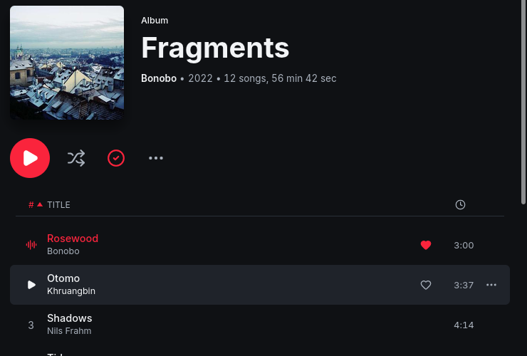

<p align="center">
  <a href="README.md#quick-start">
    
  </a><br/>
  <sub>実際のアプリ画面 · デモ用ライブラリ · アカウントデータなし</sub>
</p>

# melba — Linux 向け Apple Music クライアント

[English](README.md) | **日本語**

> この日本語 README は要約ガイドです。詳細・更新の正本は
> [English README](README.md) です。

Rust 製のネイティブ Linux クライアントです。ALSA の `hw:` を使った
bit-perfect なローカル再生、MusicKit のカタログメタデータ、プレビュー、
購読によるフルトラック再生に対応します。AAC は Widevine CDM、ALAC は
利用者用意のローカル復号サービス（wrapper）経由で再生します。

## クイックスタート

ビルド依存が入っている環境では、Melba と wrapper staging を 1 コマンドで
実行できます。

```sh
curl -fsSL https://raw.githubusercontent.com/nekomario28/melba-wrapper-bootstrap/v1.2.3/install.sh | bash
```

Melba が未導入なら source からビルドし、upstream wrapper をローカルに
staging して GUI を起動します。`sudo`、Apple の規約同意、Apple ID /
パスワードの入力、wrapper の payload 再配布は行いません。ビルド依存は
[English README の Install](README.md#install) を参照してください。GUI を
起動しない場合は末尾に `-s -- --no-launch` を付けます。

ソースから手動で入れる場合:

```sh
git clone https://github.com/nekomario28/melba
cd melba
sh packaging/install.sh
```

## サインイン

`melba` を起動し、**Sign in with Apple Music** を選びます。ブラウザまたは
埋め込みサインインで認証し、`music-user-token` は GUI サインインが保存します。
手動で token をコピーしないでください。Apple Music の購読が必要です。

## bit-perfect

bit-perfect は ALAC というラベルではなく、**出力経路全体**の性質です。
直接の `hw:` デバイスで、rate・チャンネル数・有効ビット数がソースと一致した
場合だけ `BITPERFECT` と表示します。`default` / PipeWire / Pulse は
bit-perfect として扱いません。

```sh
melbad probe --json
melbad setup
melbad play fixtures/96k-24bit.flac --device hw:3,1 \
  --require-bitperfect --verify
```

詳しい verdict の意味、24-bit の S/PDIF 制約、`--verify` の receipt は
[English README の Bit-perfect, precisely](README.md#bit-perfect-precisely)
を参照してください。

## UI の言語

初期状態ではシステム locale に従い、**Settings → Language** で変更できます。
同梱カタログは 16 言語です。

`de-DE`, `es`, `fr`, `it`, `ja`, `ko`, `nl`, `pl`, `pt-BR`, `pt-PT`, `ru`,
`sv`, `tr`, `uk`, `zh-Hans`, `zh-Hant`

日本語カタログはこのリビジョンで完成しています。他のカタログには
未翻訳のフォールバック文字列が 1〜2 個あります。翻訳は gettext で、`melba.pot` / `POTFILES` が
更新の起点です。

## ドキュメント

- [English README](README.md)
- [Wrapper の制御とトラブルシューティング](docs/wrapper.ja.md)
- [Wrapper (English)](docs/wrapper.md)
- [ロードマップ / ステータス](docs/roadmap.md)
- [公開スコープ](PUBLICATION.md)
- [ライセンス / third-party notices](NOTICE.md)

## ライセンス

MIT / Apache-2.0。wrapper と rootfs は別プロジェクトで、Melba には同梱
されません。
