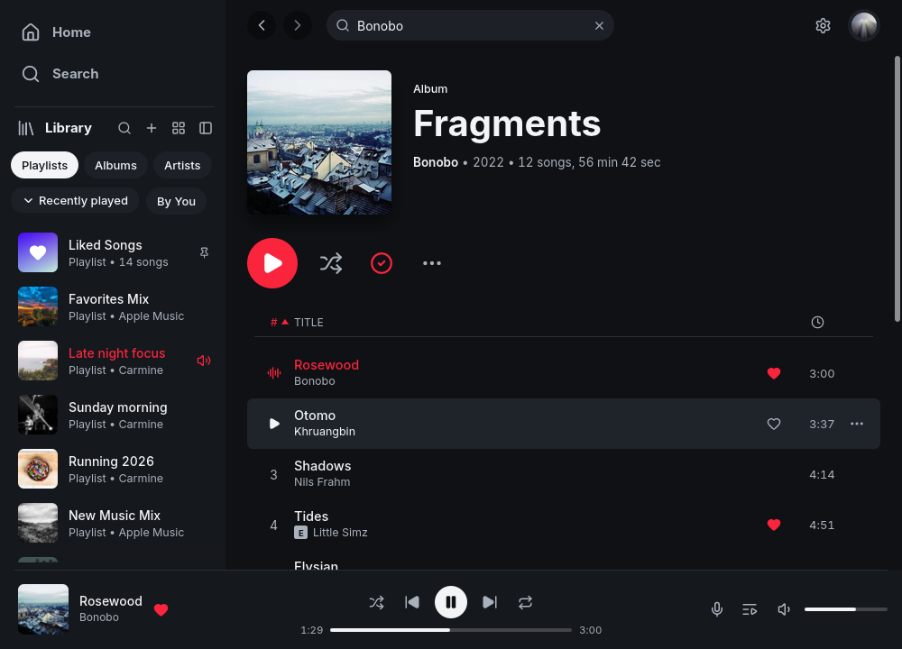

<p align="center">
  
  <br/><sub>Actual app capture · full demo window</sub>
</p>

<h1 align="center">melba</h1>
<p align="center"><strong>A native Apple Music client for Linux.</strong></p>
<p align="center">
  <a href="https://github.com/nekomario28/melba/actions/workflows/ci.yml"></a>
  <a href="https://github.com/nekomario28/melba/releases"></a>
  <a href="README.ja.md">日本語</a>
</p>

Melba is an unofficial, Rust-based Apple Music desktop player (`melba`) paired with its own playback daemon (`melbad`). It provides a native egui UI with catalog search, library and playlists, queue, synced lyrics, MPRIS media controls, 16 languages, and signed portable updates without an Electron shell.

## Install

Linux `x86_64` and `aarch64` are supported. **Recommended on modern Linux (glibc 2.43+)**: install the prebuilt, publisher-signed release without Git or Rust. Older glibc systems must build from source:

```sh
curl -fsSL https://raw.githubusercontent.com/nekomario28/melba/main/packaging/install-release.sh | sh
```

The installer verifies the release signature and binary checksum, installs both `melba` and `melbad`, and offers optional ALAC setup with `[Y/n]` when interactive. ALAC can also be added later without reinstalling; see the [single-command instructions](docs/installation.md#enable-alac-lossless). You can opt out with `--no-alac` or opt in during non-interactive use with `--with-alac` (for example `curl -fsSL URL | sh -s -- --with-alac`).

**For developers building from source** (the installer can provision missing Rust/build dependencies):

```sh
git clone https://github.com/nekomario28/melba.git
cd melba
sh packaging/install.sh
melba
```

`packaging/install.sh` installs `melba` and `melbad` under `~/.local/opt/melba`, links them in `~/.local/bin`, and adds a desktop entry. The desktop starts `melbad` on demand. See [Installation](docs/installation.md) for packaging options, alternate roots (Melba never bundles the wrapper, rootfs, or account credentials).

## Enable ALAC (lossless)

ALAC requires a separate, user-supplied decrypt service. During interactive installation you can opt in with `[Y/n]`; if Melba is already installed, the [single-command setup](docs/installation.md#enable-alac-lossless) is preferred. Alternatively, explicitly stage the independent [wrapper bootstrap](https://github.com/nekomario28/melba-wrapper-bootstrap):

```sh
git clone https://github.com/nekomario28/melba-wrapper-bootstrap.git
cd melba-wrapper-bootstrap
./install.sh --wrapper-only
melbad wrapper status
```

For wrapper-only setup, you need `git`, `curl`, `unzip`, `file`, and a C compiler (`cc`); the full [source-build dependencies](docs/installation.md#requirements) are only needed to build Melba itself. Then use Melba's GUI to sign in and play an ALAC track. The managed service starts when needed; no separate CLI password or manual token copying is required. Review the bootstrap script, its security notes, and the external runtime's terms before executing it. If the service is unavailable, playback falls back to AAC. Source losslessness and bit-perfect output are different. See the [full setup guide](docs/installation.md#enable-alac-lossless).

## Play music

Launch `melba`, choose **Sign in with Apple Music**, and pick an output device in Settings or with `melbad setup`. Full catalog tracks require a paid subscription and a valid session; previews do not.

- **AAC-256 (default):** uses a Widevine CDM already installed on the machine.
- **ALAC / lossless (optional):** requires a separately installed service; see [Enable ALAC](#enable-alac-lossless).
- **Output:** direct ALSA (`hw:X,Y`) or shared system audio (`default` / PipeWire / PulseAudio).
- **Diagnostics:** `melbad doctor` checks token validity, CDM, wrapper reachability, and audio output.

Lossless source audio and bit-perfect **output** are separate properties. Sign-in details: [Authentication](docs/authentication.md). Service modes: [Wrapper control](docs/wrapper.md).

## Bit-perfect

`default`, PipeWire, and PulseAudio are shared outputs and are never labeled bit-perfect. Only a direct `hw:` open whose granted rate, channel count, and valid sample bits match the source reports `BITPERFECT`.

```sh
melbad probe --json
melbad play fixtures/96k-24bit.flac --device hw:0,0 --require-bitperfect --verify
```

Replace `hw:0,0` with your device. Verdict rules, caveats, and receipt format are in [Audio and playback](docs/audio.md). If you use the OS mixer instead, [Shared output (PipeWire) on Linux](docs/audio.md#shared-output-pipewire-on-linux) covers pass-through conditions (single stream, rate switching without resampling, 100% volume) and the WirePlumber start-delay fix for HDMI receivers that clip the start of a track on sample-rate changes.

## Status

Unofficial; not affiliated with or endorsed by Apple Inc. The `aarch64` release is build-verified on a native arm64 runner, not run-verified on arm64 hardware. Verify live login, track availability, output hardware, and lossless playback on your own system. See [Updating](docs/updates.md) and [Roadmap](docs/roadmap.md).

## Documentation

- [Installation](docs/installation.md) · [Audio and playback](docs/audio.md) · [Authentication](docs/authentication.md)
- [Updating](docs/updates.md) · [Integrations](docs/integrations.md) · [Development](docs/development.md)
- [Wrapper control](docs/wrapper.md) · [日本語](docs/wrapper.ja.md) · [Roadmap](docs/roadmap.md)
- [Publication scope](PUBLICATION.md) · [Third-party notices](NOTICE.md) · [Agent-facing specs](specs/README.md)

## Contributing and issues

Bug reports and pull requests are welcome. For bugs, include log output and reproduction steps; for feature ideas, open an issue first to discuss the workflow. Please check [`CONTRIBUTING.md`](crates/melba/CONTRIBUTING.md) for project principles and out-of-scope boundaries (e.g. no embedded browsers, third-party catalogues, or DRM bypasses).

## Credits and license

The desktop frontend derives from [Spotifast](https://github.com/crmne/spotifast) by Carmine Paolino; its original notice is retained in [`crates/melba/LICENSE`](crates/melba/LICENSE). Daemon and shared code are MIT OR Apache-2.0; the Spotifast-derived desktop crate is MIT-only. See [NOTICE.md](NOTICE.md).

Apple Music and related marks are trademarks of Apple Inc. Use of Apple's services is subject to Apple's terms. Never share account credentials, session tokens, or sign-in profiles.
